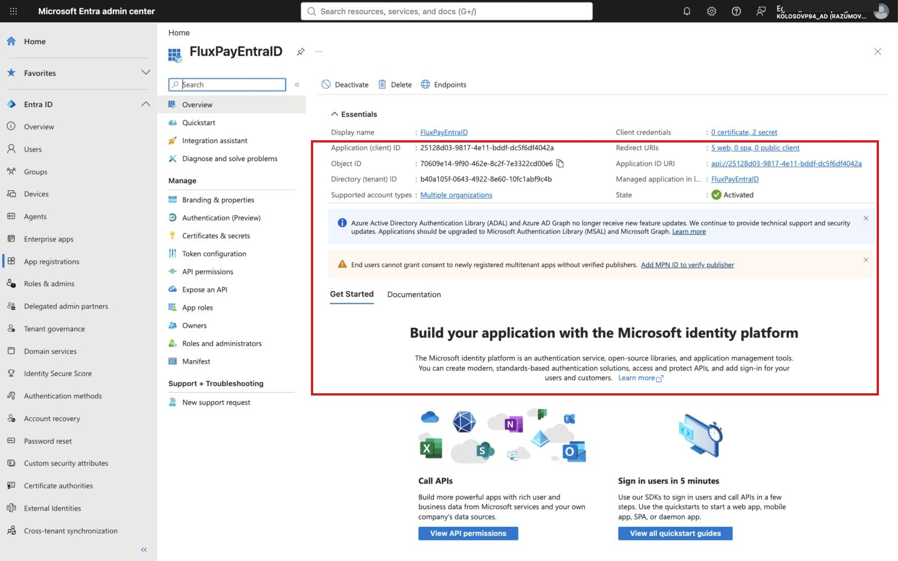
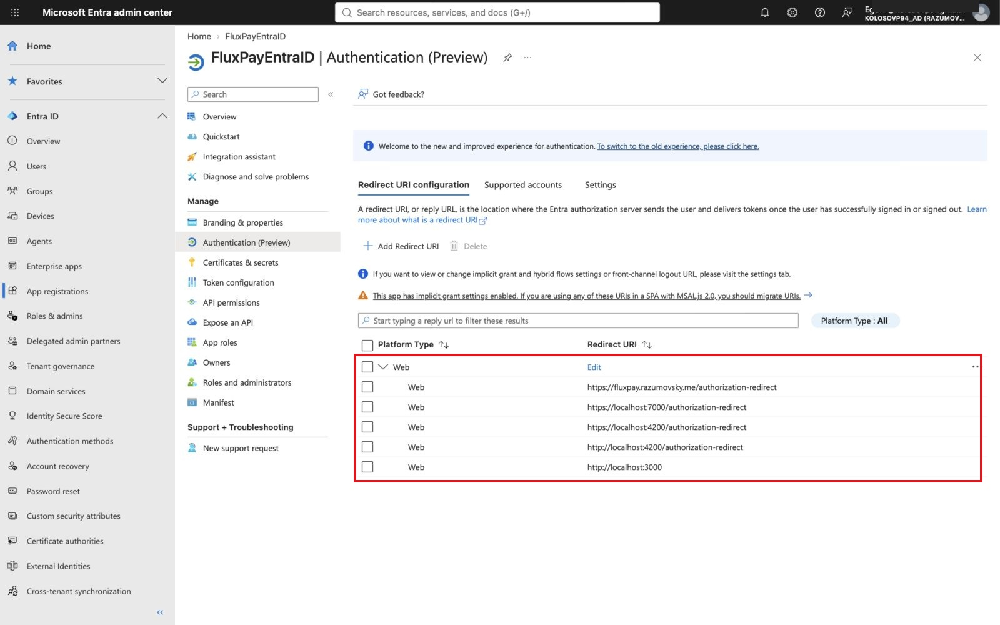
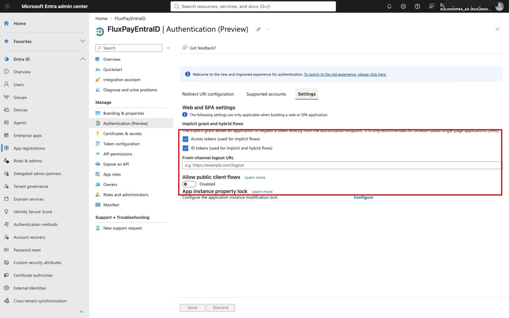
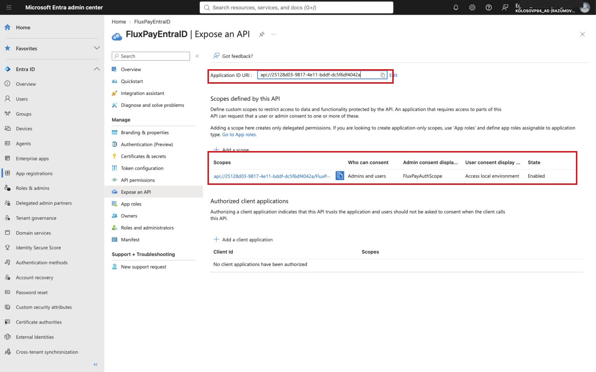
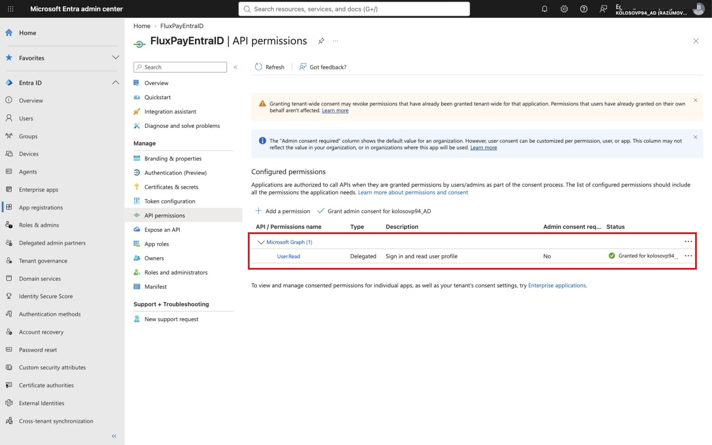
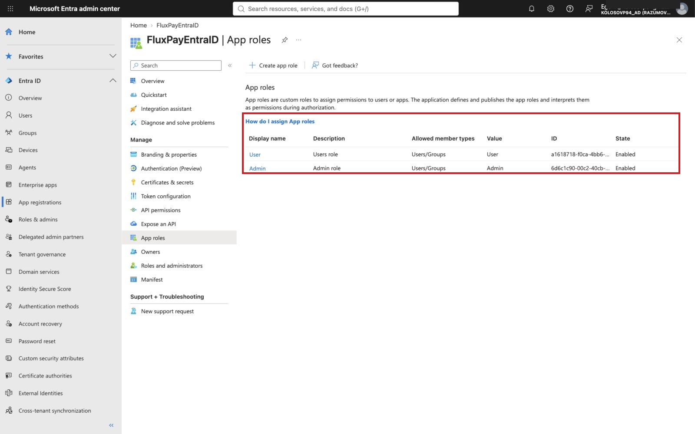
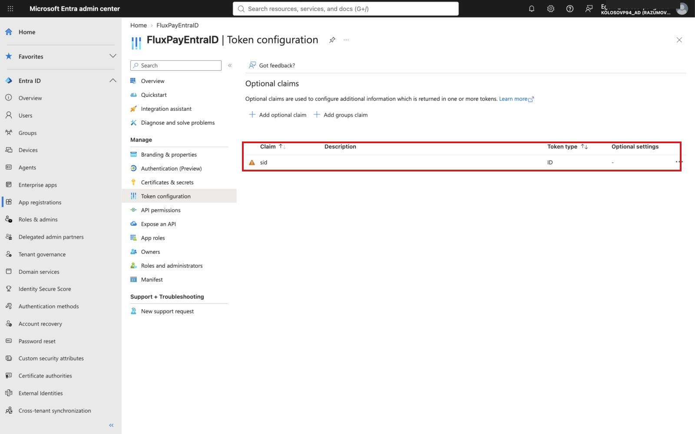
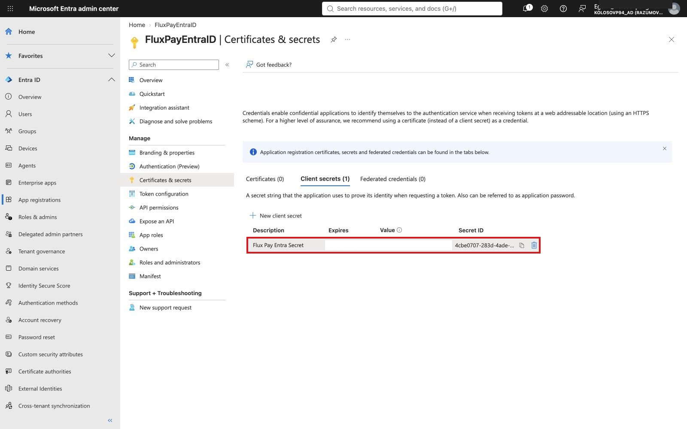

# Microsoft Entra ID setup for FluxPay

Use this guide to recreate the FluxPay app registration in a Microsoft Entra tenant. The [Microsoft Graph manifest reference](entra-manifest.json) includes the registration settings and identifiers. Credential values and timestamps are omitted.

## 1. Register the application

In the Microsoft Entra admin center, go to **Entra ID → App registrations → New registration**. The existing registration is named **FluxPayEntraID**. Select **Accounts in any organizational directory** (`AzureADMultipleOrgs`).

- **Application (client) ID** — `25128d03-9817-4e11-bddf-dc5f6df4042a`.
- **Directory (tenant) ID** — `b40a105f-0643-4922-8e60-10fc1abf9c4b`.
- **Object ID** — `70609e14-9f90-462e-8c2f-7e3322cd00e6`.

Copy the client and tenant IDs for the new registration from **Overview**. The object ID identifies the directory object for administrative lookups.

## 2. Configure authentication

Under **Authentication**, add the **Web** platform. The existing registration includes these redirect URIs.

- `https://fluxpay.razumovsky.me/authorization-redirect`
- `https://localhost:7000/authorization-redirect`
- `https://localhost:4200/authorization-redirect`
- `http://localhost:4200/authorization-redirect`
- `http://localhost:3000`

Use the public HTTPS host of the target ingress for the deployed callback. Match the local entries to the launch profiles you use. Compare the full `redirect_uri` in the authorization request with its Web entry.

To reproduce the existing authentication settings, enable **Access tokens** and **ID tokens** under **Implicit grant and hybrid flows**. Leave **Front-channel logout URL** empty and **Allow public client flows** disabled. The SPA and public client redirect URI lists are empty. FluxPay's main sign-in flow uses authorization code with PKCE.

## 3. Expose the API scope

In **Expose an API**, set the **Application ID URI** to `api://<CLIENT_ID>`. Add the enabled scope `FluxPayAuth.All` with these settings.

- **Who can consent** — Admins and users.
- **Admin consent display name** — FluxPayAuthScope.
- **Admin consent description** — Flux Pay Auth Scope.
- **User consent display name** and **description** — Access local environment.
- **Authorized client applications** — empty.

## 4. Configure Microsoft Graph permissions and consent

Under **API permissions**, verify **Microsoft Graph → Delegated permissions → User.Read**. This is the only configured permission in the existing registration. If Entra adds it during registration, use the existing entry.

The source tenant shows **No** under **Admin consent required** and **Granted for kolosovp94_AD** under **Status**. To reproduce the tenant-wide grant, an administrator in the target tenant can select **Grant admin consent** after the permission is configured and then verify its status. The manifest records the configured permission. Verify the grant separately in the portal.

## 5. Add app roles and the optional claim

In **App roles**, create two enabled roles with **Users/Groups** as the allowed member type.

- Set **Display name** and **Value** to `User`. Set **Description** to `Users role`.
- Set **Display name** and **Value** to `Admin`. Set **Description** to `Admin role`.

Assign the roles to the appropriate test users in the corresponding **Enterprise application**. Check the resulting claims in a fresh sign-in session.

In **Token configuration → Add optional claim**, add `sid` to the **ID token**. The manifest shows `None` for `groupMembershipClaims`.

## 6. Create the client secret and configure FluxPay

Go to **Certificates & secrets → Client secrets → New client secret**. Create a secret for FluxPay and store its **Value** in the application's secret store as soon as Entra displays it. Use the value when configuring Authorization. The existing registration has one client secret named **Flux Pay Entra Secret**, with no certificates or federated credentials.

Set these environment variables for Authorization.

- `AzureAd__TenantId` and `AzureAd__ClientId` — the IDs of the target tenant and new registration.
- `FLUXPAY_AD_CLIENT_SECRET` — the new secret's **Value** from the secret store. Authorization reads this environment variable directly.
- `AzureAd__Authority` — `https://login.microsoftonline.com/<TENANT_ID>/v2.0/`.
- `AzureAd__AzureAdTokenUrl` — `https://login.microsoftonline.com/<TENANT_ID>/oauth2/v2.0/token`.
- `AzureAd__Scopes` — `api://<CLIENT_ID>/FluxPayAuth.All openid offline_access`.
- `AzureAd__CallbackPath` — `/authorization-redirect`.
- `AzureAd__RedirectUri` — `http://localhost:3000` in the checked-in Authorization appsettings. Match this value to the redirect URI used by the corresponding code exchange.
- `AzureAd__Instance` — `https://login.microsoftonline.com`.

Update `AzureAd__TenantId`, `AzureAd__ClientId`, `AzureAd__Instance`, and `AzureAd__Scopes` for Sender and Consumer as well. Both services validate JWTs through `AddMicrosoftIdentityWebApi`. Check token issuer and audience after switching registrations.

### Where to set the values

- **IDE or dotnet** — Pass the variables to the Authorization process. The HTTPS launch profile uses `https://localhost:7000`. Use `dotnet dev-certs https --trust` to trust the development certificate on a supported system.
- **Docker Compose** — The Compose file passes `FLUXPAY_AD_CLIENT_SECRET` from the environment. Set additional variables for the relevant containers in a local Compose override. The default Compose mapping exposes Authorization at `http://localhost:7000`. If you use the registered HTTPS callback on that port, configure a matching HTTPS endpoint.
- **AKS** — Set public configuration in Helm values under `env`, including the `AzureAd__Scopes` override in the GitOps overlay. The Authorization chart sources `FLUXPAY_AD_CLIENT_SECRET` from the key of the same name in the `azure-ad-auth` Kubernetes Secret in the release namespace. The deployment uses SOPS for GitOps secrets. Match the public ingress host to the Web callback.

[Authorization appsettings](../../src/authorization/FluxPayAPI.Authorization.Presentation/appsettings.json) · [Authorization Helm chart](../../charts/authorization/README.md) · [Docker Compose](../../docker-compose.yaml)

## 7. Verify sign-in

1. Start the HTTPS sign-in flow and inspect the tenant, client ID, scopes, and full `redirect_uri` in the authorization request.
2. Sign in as a test user. Verify the callback, authorization-code exchange, session creation, and token refresh.
3. Check the expected `scp`, `sid`, and role claims for test users. For `AADSTS50011`, compare the callback scheme, host, port, and path. If ingress generates an incorrect callback, check forwarded headers and reverse proxy configuration. For a client secret error, check its expiry and confirm Authorization received the secret **Value**.

[Register an application](https://learn.microsoft.com/en-us/entra/identity-platform/quickstart-register-app) · [Configure redirect URIs and credentials](https://learn.microsoft.com/en-us/graph/auth-register-app-v2) · [Expose a scope](https://learn.microsoft.com/en-us/entra/identity-platform/scenario-protected-web-api-expose-scopes) · [Grant admin consent](https://learn.microsoft.com/en-us/entra/identity/enterprise-apps/grant-admin-consent)
