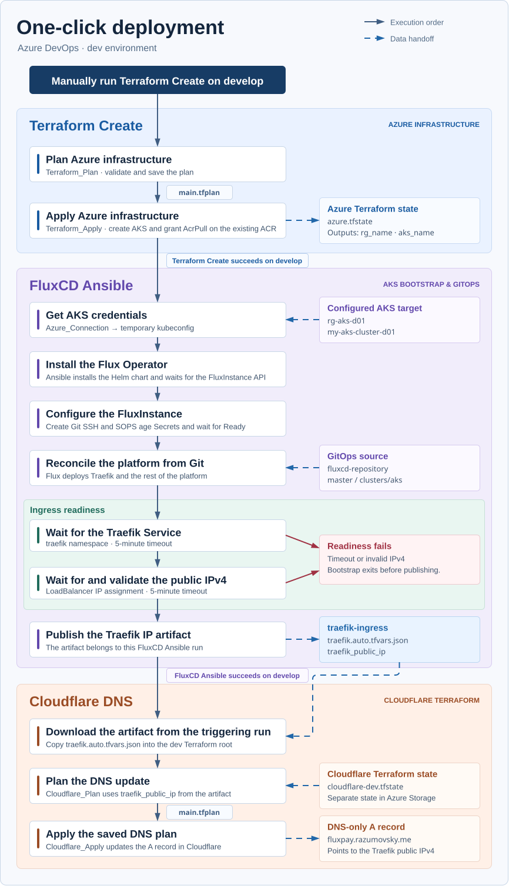

# One-click deployment

In Azure DevOps, go to **Pipelines → Infrastructure → Terraform Create** and
run it on `develop`. A successful run starts **FluxCD Ansible**, which starts
**Cloudflare DNS** after publishing the Traefik public IPv4. Both Terraform
apply stages use the `dev` environment and honor any checks configured there.

## Prerequisites

- Provision the three pipelines and their permissions. Keep `develop` as the
  default branch for **FluxCD Ansible** and **Cloudflare DNS** so Azure DevOps
  reads their completion triggers from that branch. [Azure DevOps setup](azure-devops/README.md)
- Give **Terraform Create** Azure credentials through `Terraform_Azure_Credentials`
  and access to the existing ACR `acrsharedd01` to assign `AcrPull`. Both Terraform
  pipelines use the Azure Storage backend in `Terraform_Backend_StateFile_Settings`.
  [Azure infrastructure setup](infrastructure/README.md)
- Give **FluxCD Ansible** access to AKS through `Azure_Connection`, access to the
  playbook through `FluxCD_Ansible_GitHub`, and `ANSIBLE_VAULT_PASSWORD` through
  `FluxCD_Ansible_Vault`. The encrypted Vault supplies Flux's GitOps SSH key and
  SOPS age key. [Ansible bootstrap setup](https://github.com/FluxPayProject/fluxcd-operator-install-ansible#azure-pipelines)
- Give **Cloudflare DNS** a DNS token for the existing `razumovsky.me` zone through
  `Cloudflare_API_Key`. [Cloudflare setup](cloudflare/README.md)

## Deployment flow

- **Azure → FluxCD.** Azure Terraform records `rg_name` and `aks_name` in
  `azure.tfstate`. The completion trigger starts bootstrap, which uses its own
  matching settings (`rg-aks-d01` and `my-aks-cluster-d01`) to obtain a temporary
  kubeconfig. Update those settings together with any Terraform naming changes.
  [Terraform outputs](infrastructure/environments/dev/outputs.tf) · [Bootstrap pipeline](../.azdo/infrastructure/fluxcd-ansible.yml)
- **Ingress → Cloudflare.** Bootstrap waits up to five minutes for the Traefik
  Service in the `traefik` namespace and up to five more for its LoadBalancer IP. It
  validates the IPv4 and publishes `traefik_public_ip` in `traefik.auto.tfvars.json`.
  Cloudflare downloads the `traefik-ingress` artifact from the triggering run
  before planning and saves state separately in `cloudflare-dev.tfstate`.
  [Readiness check](../.azdo/infrastructure/provision_fluxcd.py) · [DNS pipeline](../.azdo/infrastructure/terraform-dns.yml)

## Verify and retry

After **Cloudflare_Apply** succeeds, confirm the A record resolves to the IPv4
in `traefik-ingress` and open [FluxPay over HTTPS](https://fluxpay.razumovsky.me/app/transactions).
If HTTPS is still unavailable, check the Flux `fluxpay` Kustomization and the
cert-manager certificate. [Platform validation](https://github.com/FluxPayProject/fluxcd-repository/blob/master/docs/aks-platform.md#validation)

If bootstrap fails or Traefik times out, fix the cause and rerun **FluxCD Ansible**
on `develop` against the existing AKS cluster. To refresh the DNS plan using the
live IP, rerun bootstrap so it publishes a fresh artifact and triggers
**Cloudflare DNS**. Standalone `main` runs of **Cloudflare DNS** use the IP from
the Terraform variable default.
